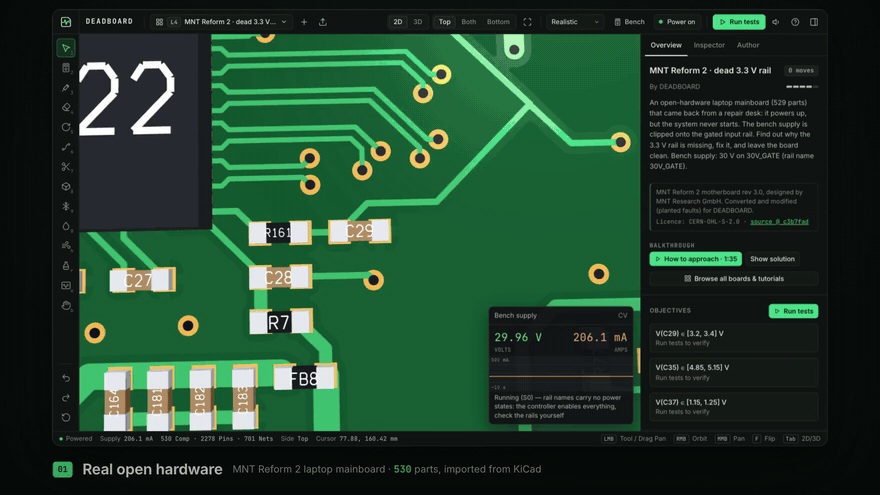

<p align="center">
  
</p>

<p align="center"><b>Board-level repair trainer.</b> Diagnose and repair simulated circuit boards on a realistic bench, right in the browser.</p>

<p align="center">
  
</p>

<p align="center">
  <b><a href="https://deadboard.org/">▶ Try it in your browser</a></b> ·
  <a href="https://github.com/tholtman1-del/deadboard/releases/latest">Watch the 1-minute showcase (MP4)</a>
</p>

---

DEADBOARD puts a broken board on your bench and gives you the tools a repair technician uses.
You probe, reason, rework and prove the fix. The circuit runs on a SPICE-style simulator, so
the meter reads what the circuit really does, not a scripted answer.

- **Real instruments.** Multimeter (V, Ω, diode, capacitance, current in series), bench supply
  with current limit, oscilloscope, thermal camera, freeze spray, IPA, rosin.
- **Real rework.** Soldering iron, hot air, desoldering wick, trace cutter, jumper wire, fitting
  new parts. Joints can be cold, pads can lift, and a blob in the wrong place shorts a rail.
- **Real boards.** Besides hand-made training boards it imports KiCad designs. Two
  open-hardware boards ship as demos: the **MNT Reform 2** laptop mainboard (530 parts) and an
  **Antmicro Jetson** baseboard (392 parts).
- **Repair challenges.** Each scenario has test-bench objectives. Pass them all, with the circuit
  back to its reference design, and an encrypted flag unlocks. Build and share your own in the
  Author tab: plant shorts, opens, leaks, drift and intermittent faults.
- **Endless practice.** Fixed a board? Generate a new problem on it: 1–3 random faults (cracked
  traces, bridges, cold joints, reversed, wrong, missing or dead parts; leaks and drift on SPICE),
  each checked to fail the bench without burning anything, with notes that go from where to look
  to the fix.
- **Walkthrough videos.** Every premade scene has a "how to approach" video and a separate,
  spoiler-gated solution video, recorded from the real app.
- **Honest numbers.** Where a value is estimated or a waveform is synthesized, the app says so.

## Run it

You need Node.js 20+ and a recent browser. The bench draws with WebGPU where the browser offers
it and falls back to WebGL2 otherwise (blocklisted GPUs, older Safari, Firefox without WebGPU);
add `?renderer=webgl2` or `?renderer=webgpu` to the app URL to force one.

```bash
npm install
npm run dev        # http://localhost:5173
npm test           # simulator, import, physics and scenario tests
npm run build      # static site in dist/
```

## Scenarios

| | |
|---|---|
| **Beginner** | First Light, Cold Joint 101, Solder Bridge 101, One-Way LED, Resistor & Ohm's Law, Voltage Divider 101 |
| **Training boards** | Bridge Troll, Backwards Day, Ghost Short, Smoke Test, The Sagging Rail |
| **Open-hardware demos** | MNT Reform 2 · dead 3.3 V rail; Antmicro baseboard · no 3.3 V, flaky 5 V |

Import your own board: KiCad `.kicad_pcb`, a boardview (OpenBoardView/TopTest or BRD2 `.brd`,
Tebo-ICT `.tvw`), or a shared `.pcbfix.json` challenge.

Languages: English and Russian (picked from the browser, or with the language menu). To add one,
see [docs/TRANSLATING.md](docs/TRANSLATING.md).

## Feedback

Found a bug or have an idea? Press the speech-bubble button in the bench (or **Feedback** on the
homepage). No account needed: the message is emailed to the maintainer, with optional technical
details (browser, GPU, board, view) so the problem can be reproduced. With a GitHub account you can
also [open an issue](https://github.com/tholtman1-del/deadboard/issues/new/choose).

The form delivers through [FormSubmit](https://formsubmit.co). The destination is a build setting,
`VITE_FEEDBACK_TO` (an address, or the alias FormSubmit sends after its one-time activation): put it
in `.env.local` for local builds, and in the repository variable `FEEDBACK_TO` for GitHub Pages.
Without it, the form falls back to a prefilled GitHub issue.

## Docs

- [docs/DEMOS.md](docs/DEMOS.md): how the demo boards are built from upstream KiCad sources
- [docs/VIDEOS.md](docs/VIDEOS.md): how the walkthrough videos are recorded
- [docs/BRAND.md](docs/BRAND.md): name, logo, colour, type and voice
- [docs/SIMULATION_HANDOFF.md](docs/SIMULATION_HANDOFF.md): simulator architecture, models and open items

## Licence

DEADBOARD is licensed under the [Apache License 2.0](LICENSE). The demo boards in
`public/demos/` keep the licences of their source designs (CERN-OHL-S-2.0 and Apache-2.0); see
[NOTICE](NOTICE) and [public/demos/NOTICE.txt](public/demos/NOTICE.txt). MNT Reform is a
trademark of MNT Research GmbH and Jetson a trademark of NVIDIA; no endorsement is implied.
